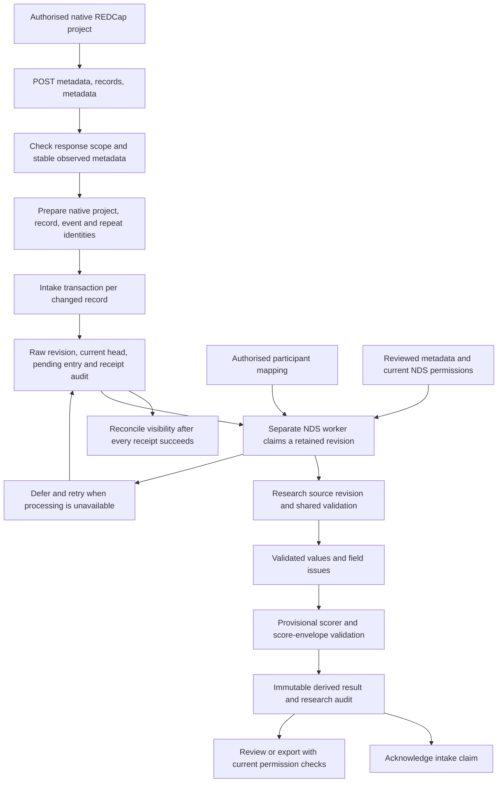

# V3.1 data lineage

Reviewed for L04 on 27 October 2026, starting at `e9ee1fb`. L04 and all subsequent local data engineering tasks continue on `de/local-data-engineering-tasks`. This describes the independent source collector and the separate NDS processing classes in this checkout. The development `ingest-v31` command follows a different path, described below.

## Source receipt and NDS processing

The command `python -m etl.main collect-source` calls [source_runtime.py](../etl/sync/source_runtime.py), which builds the native client, configured source grant and intake store. CLI `sync` delegates to this command when source intake is enabled. Its retired dry-run and metadata-only modes fail before collection. The old `SyncOrchestrator.sync` method remains disabled.

Source receipt requires configured project, endpoint, service identity, source destination and event mode. Native HTTP requires HTTPS, a token and an explicit export policy. These settings do not prove country-transfer, ethics or live access approval. Operators must establish those permissions before enabling a source environment.

The collector does not resolve an NDS registration, mapping, consent or score. [DownstreamProcessor](../etl/sync/v31_workflow.py) is a separate class that needs a worker intake policy, participant links, trusted repository policy and reviewed metadata. This checkout has no supported processing CLI or production NDS adapter wired to that class. The collector's configured grant permits only `receive` and `reconcile` for `source-collector`.

## Native HTTP contract and failure handling

[ProductionRedcapClient](../etl/extract/production_client.py) sends form-encoded POST requests. A full snapshot uses `content=metadata`, then `content=record`, then metadata again. The record request sets JSON output, flat rows, raw values and headers, unique event names, survey fields and data-access groups. It sends no field, form, record or completion filter. The collector deliberately ignores its legacy `since` and `full` arguments and requests full reconciliation, so a creation-time watermark cannot hide late corrections.

The source snapshot retains all observed metadata columns and all authorised response keys. It allows fields declared in current metadata, flattened checkbox keys and native event, repeat, survey, data-access-group, form-completion and timestamp keys. An undeclared response key fails scope validation. A newly declared field is retained even when the historical 223-field contract does not recognise it. Historical drift is reported and later interpretation can be deferred.

Metadata must be a nonempty list with unique nonempty field names and string form names. Records must be a list of objects with nonempty native string IDs. Metadata before and after the export must have the same canonical digest. A change restarts the snapshot, for at most three snapshot attempts. This brackets the metadata observations, but does not establish a transactional snapshot of records in the remote REDCap database.

Each HTTP request has a timeout between 1 and 120 seconds and at most 1 to 5 configured attempts. Only timeouts, connection errors and HTTP 429, 502, 503 and 504 retry. Backoff doubles and caps at 8 seconds. SSL failures, redirects, permission failures and other response errors stop the request. TLS verification stays enabled, redirects stay disabled and the policy is rechecked before each attempt. JSON parsing and transport errors expose fixed messages without server bodies, IDs, tokens or endpoint URLs. The collection CLI emits only a fixed failure reason or counts and a metadata digest.

All response IDs and event/repeat contexts are prepared before the first receipt. Malformed later identities therefore cannot create a partial batch. A storage failure can interrupt the per-record transactions after earlier records commit. Those earlier receipts remain durable, and replay resumes without duplicating unchanged revisions. Reconciliation runs only after every receipt succeeds.

A successful export that omits an earlier identity adds `not_seen_in_full_export` audit evidence. A later full export can add `seen_in_full_export`. Neither marker deletes data, cancels processing permission or establishes withdrawal. Absence reflects visibility to the current credential. A successful empty export follows the same rule.

## Identity and field mapping

Intake identity has `project`, `source_id`, `event`, `instrument` and `instance`. Its digest also includes destination. Research identity retains the native source ID under the historical key `participant`. It includes project, event, instrument and instance, with destination handled separately in research revision uniqueness. Neither identity uses an NDS ID as a replacement for the native ID.

| Observed input | Retained destination | Interpretation |
| --- | --- | --- |
| Entire flat record object | `nds_v31_intake_raw.payload`, then authorised `nds_v31_source.payload` | JSON values remain unchanged. Missing keys, nulls, empty strings, numeric types and unknown declared fields remain distinct. JSON whitespace and key order are not preserved as transport bytes |
| First native metadata field and its row value | Intake `record_id_field` and identity `source_id` | Actual source ID is retained. The historical research adapter still requires `study_id`. A renamed source ID needs an explicit reviewed downstream adapter, never an invented answer |
| `redcap_event_name` | Raw payload plus identity `event` | Classic mode requires empty or absent event, longitudinal mode requires a nonempty string, auto mode accepts either. No event is fabricated |
| `redcap_repeat_instrument` | Raw payload plus identity `instrument` | Must be a string. A nonempty instrument requires a positive instance |
| `redcap_repeat_instance` | Raw payload plus identity `instance` | The identity uses a positive integer string. Native integer JSON values also match that identity without rewriting the payload. Booleans, floats and mismatched instances fail |
| All observed API metadata | Intake `metadata_snapshot` and `metadata_hash` | Retained before metadata approval or analytical interpretation |
| Reviewed 18-column dictionary adaptation | Research `source_metadata` and `source_metadata_hash` | Converts native metadata keys to the dictionary headers. Additional API metadata columns require adapter review before processing |
| All 223 historical fields | Raw JSON fields of the same name | See the complete [dictionary](DATA_DICTIONARY_V31.md). There is no separate SQL column per questionnaire item |
| 188 respondent questions and technical control | `nds_v31_validated.values` and `.issues` | Shared validator applies field-specific types, codes, bounds and branches. Unavailable analytical values are excluded without deleting raw answers |
| `age_years` | Raw answer and validator report | Inclusive 12 through 24. Age eligibility is separate from receipt, consent and cohort selection |
| Raw `country` code | Raw answer plus research `country` scope label | Trusted current NDS country supplies scope. An omitted repeat-country answer stays omitted. A conflicting observed country denies research ingestion |
| Source form status and completion fields | Raw payload and completion review | Completion is not consent or proof that every required analytical answer exists |
| Verified later NDS registration | `nds_v31_participant_links.nds_id`, research `nds_participant_id`, derived provenance | Separate project/source mapping, with an explicit mapping version and authorisation at binding |
| Intake revision UUID | Research `intake_revision_id` and derived result | Connects a specific retained source revision to interpretation and scoring |
| Validated core answers, issues and external applicability | `nds_v31_derived.result` | Ten provisional scores, exact rational JSON values, unavailable reasons and provenance |

[ParticipantLinks](../etl/repository/participant_links.py) binds a separate NDS ID to a project/source pair. It does not create a person, issue an ID or grant consent. Rebinding to a different ID or mapping version requires a separately reviewed correction. The mapping table is shared across destinations within its warehouse schema. Destination-specific processing and export still require current permission checks.

The [repository](../etl/repository/v31.py) requires a trusted current registration, purpose-processing permission, consent, action permission, approved storage destination and transfer permission. It checks the mapped NDS ID against that registration. Review, export and derived writes recheck current scope. Source fields cannot supply these grants.

## Validation and scoring

[The shared validator](../etl/validation/v31_validator.py) runs when a research revision is ingested. Its values and field issues belong to that revision. Review can recompute quality using the retained metadata and current validation code. See [quality rules](DATA_QUALITY_RULES.md) for missingness, branch logic and score-envelope checks.

The worker uses the retained metadata digest to select an explicitly approved metadata version, or compares against the local reviewed dictionary. Unadaptable or unreviewed metadata defers processing without removing the receipt. Approval of a metadata version does not change the scorer's historical core membership or scientific rules.

The worker passes validated values and semantic issue reasons to [Scorer](../etl/scoring/v31.py). EPI applicability defaults to unverified. Scores remain provisional and do not select participants or make clinical decisions. [The scoring document](SCORING_ALGORITHM.md) describes the formula and unresolved owner decisions. Derived values use numerator/denominator objects rather than float conversion, with null and explicit issues when unavailable.

A research source revision, its validation layer and ingest audit commit together. Derived storage and queue acknowledgement are later transactions. A failure between them can leave a research revision or derived result awaiting a queue retry. Immutable calculation keys and idempotent acknowledgement support recovery without deleting the raw revision. Every retained intake revision remains queued independently, including corrections. Research revisions are complete observations, never patches merged with earlier answers.

## Nine-table storage model

| Table | Key, relationships and constraints | Purpose |
| --- | --- | --- |
| `nds_v31_intake_raw` | UUID primary key, unique identity/revision and identity/revision/UUID, positive revision, PostgreSQL JSON identity project equals project column | Original JSON, metadata, native identity, source version, hashes, receive time and destination per revision |
| `nds_v31_intake_head` | Identity primary key, source UUID foreign key, composite identity/revision/UUID foreign key, positive revision | Current receipt pointer must reference the matching retained revision |
| `nds_v31_intake_pending` | Source revision primary and foreign key, allowed-state check, nonnegative attempts, required token/actor/lease for processing and acknowledged states | Pending, retry, processing and acknowledged state per receipt |
| `nds_v31_intake_audit` | UUID or deterministic presence-marker primary key, intake revision foreign key | Received, claimed, ack/fail, requeued and visibility-marker actions with actor and epoch timestamp |
| `nds_v31_participant_links` | Composite project/source ID primary key, no cross-system foreign key | Separate NDS ID and mapping version. No destination or actor/timestamp columns |
| `nds_v31_source` | UUID primary key, unique identity/destination/revision, positive revision | Authorised research observation, raw payload, reviewed metadata, native identity, NDS ID, hashes and observed time |
| `nds_v31_validated` | Source UUID primary and foreign key | One analytical values/issues layer per research revision |
| `nds_v31_derived` | UUID primary key, source foreign key, unique source/calculation version | Immutable derivation result for that exact research revision |
| `nds_v31_audit` | UUID primary key and source foreign key | Ingest, replay, derive, review and export actions with actor and UTC string timestamp |

Intake has `ix_pending_ready` on state, next-attempt time and lease expiry, and `ix_intake_scope` on project, destination, receive time and revision. Primary and unique constraints supply their own indexes. The research, mapping and audit tables have no additional declared secondary indexes. The foreign keys do not all have separate indexes. This review establishes correctness for synthetic cases, not performance at production volume.

Research `intake_revision_id` and NDS IDs are provenance strings, not database foreign keys to intake or the external registry. Worker code connects them. SQL constraints do not independently enforce current consent, mapping correctness, payload hashes, append-only access or scientific validity. Intake head movement and queue state updates are expected mutable operations. Raw/audit immutability also depends on deployed roles and privileges, which the synthetic role tests exercise separately.

PostgreSQL uses an explicit validated `WAREHOUSE_SCHEMA`. [The engine factory](../etl/load/db.py) applies SQLAlchemy schema translation and hides parameters. [Alembic](../alembic/env.py) sets a quoted selected-schema search path followed by `pg_catalog`, requires the schema to exist and rejects migration history in another schema. Transaction advisory locks serialize same-identity receipt, research revision, mapping and derivation operations. PostgreSQL queue claims use row locking with `SKIP LOCKED`.

The migration chain is `001_initial`, `002_independent_source_intake`, `003_legacy_columns`, then `004_storage_integrity`. Migration 001 owns legacy `redcap` tables. Migration 002 creates the nine tables. Migration 003 adds nullable legacy columns, and 004 strengthens destination uniqueness, head linkage, checks and indexes. Frozen migrations remain unchanged. [repository/migration.py](../etl/repository/migration.py) is a four-table synthetic helper, not a substitute for the warehouse migration chain.

Migration 001 has a destructive legacy schema downgrade. Migration 002 refuses offline rollback and rollback of nonempty retained tables. Migrations 003 and 004 require forward repair rather than downgrade. No existing database was migrated for L04. Offline SQL review and execution in a new disposable PostgreSQL fixture are separate evidence.

## Hashes and audit meaning

Canonical JSON hashing uses sorted keys, compact separators, UTF-8, literal Unicode and no NaN. Array order remains meaningful. A byte hash of a file is a different measurement.

| Stored hash or key | Actual input and meaning |
| --- | --- |
| Intake `identity_key` | SHA-256 of `{source_identity, destination}`. Source identity includes project, source ID, event, instrument and instance |
| Intake `payload_hash` | SHA-256 of `{payload, source_version, contract_hash, record_id_field, metadata_hash}`. Despite its name, it covers more than the payload. A metadata or version change creates a revision even if answers match |
| Intake `metadata_hash` | Canonical digest of the entire observed native API metadata list. Also returned as collection `metadata_sha256` |
| Intake and research `contract_hash` | Canonical digest of the parsed historical contract, not the contract file's exact bytes |
| Research `identity_key` | Digest of `{project, participant, event, instrument, instance}`. Destination is separate in revision uniqueness and locking |
| Research `change_hash` | Digest of `{payload, source_version, source_metadata, intake_revision_id, nds_participant_id, contract_version, contract_hash}`. Used for idempotent latest-revision comparison |
| Research `source_metadata_hash` | Digest of the adapted dictionary rows. It differs from the native API metadata hash because the keys differ |
| Derived `contract_sha256` | Canonical contract digest used by the scorer |
| Derived `algorithm_version` | Algorithm label plus digest of contract digest and scorer code byte digest |
| Derived `source_sha256` | Digest of supplied core response keys, semantic missingness, external EPI applicability and source context. Worker context contains research UUID, intake UUID, source version, NDS ID and metadata policy version |
| Derived `calculation_version` | Algorithm version joined to score-input digest. Unique within a research source revision |
| Derived provenance | Intake UUID, native metadata digest, NDS ID, mapping version and metadata policy version are also stored explicitly |

An unchanged intake replay returns the existing UUID and does not add a new receipt audit. An unchanged research replay returns the existing UUID and adds `replay` audit evidence. The source version is a caller-supplied label, not proof of a source edit timestamp. Intake `received_at` is epoch seconds. Research `observed_at` and audit `at` are application-generated UTC ISO strings. None establishes when the source participant answered a question.

Hashes detect input differences within these defined inputs. They are not signatures, an audit hash chain, encryption, an external timestamp or proof that a database administrator cannot alter retained rows. Source and scoring digests are not interchangeable. Historical development-shortcut digests use different inputs and JSON serialization.

## Mock limitations and deferred work

[MockRedcapClient](../etl/extract/mock_client.py) uses custom GET endpoints and synthetic metadata. Its legacy multi-endpoint export constructs IDs, events and `_instrument`, uses a 500-participant limit without a complete-project pagination proof, and filters dates using available mock fields. Its fields/events arguments do not implement native selection. It has one GET attempt with requests' usual redirect behaviour, rather than the native client's retry and redirect policy. These behaviours do not establish native REDCap compatibility.

The separate `ingest-v31` shortcut calls the mock baseline GET endpoint and writes research source and derived tables directly. It bypasses intake, NDS policy, shared validation and the supported audit/queue flow. Its scalar float score JSON also differs from the supported result envelope. It remains development-only under the existing scope decision.

| Deferred item | Required before production use |
| --- | --- |
| N01 intake and policy bypass | Route through retained receipt, queue and current permissions |
| N02 correction/history loss | Retain new revisions and replay safely |
| N03 configured-schema access | Qualify raw SQL using the selected warehouse schema |
| N04 identifier collisions | Scope source and calculation IDs by project, destination and revision |
| Actual service acceptance | Verify deployed metadata, native ID, events/repeats, DAG/rights, destination permissions, source snapshots and authorised test scope in DE04/L09 |
| Scientific and operational approval | Approve selection/applicability rules, production roles, retention, recovery targets and deployment independently |

The held queue CLI proposal is not included in this checkout and is not evidence of a supported production worker. L04 does not close that review or the deferred shortcut repairs. PostgreSQL results use only new synthetic databases. L08 still owns its later complete acceptance package, including SQL deliverables from L05, and L09 owns actual service checks.

Local evidence, exact commands, schema inventory, integrity hashes, defect reproduction and test results are in the Obsidian task folder's `evidence/L04-review.md` and `evidence/L04/`.
